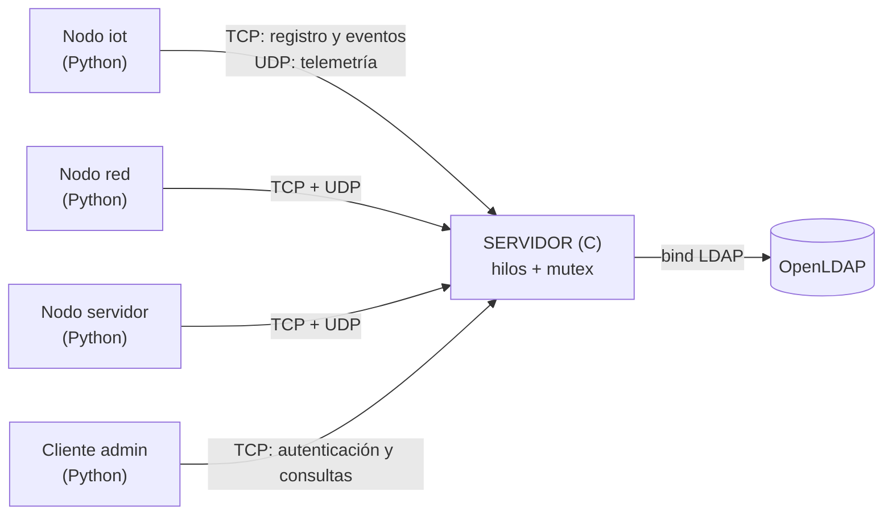

# SMCD — Sistema de Monitoreo y Control Distribuido
 
Proyecto de **Internet: Arquitectura y Protocolos** (Telemática, 2026-2).
 
Sistema de monitoreo de infraestructura construido con **sockets Berkeley**. Varios **nodos** reportan su estado a un
**servidor central escrito en C**, y un **cliente de administración** consulta ese estado. Nodos y clientes nunca se
comunican directamente: todo pasa por el servidor. La autenticación de los administradores está **centralizada en
LDAP** (OpenLDAP) y distingue perfiles.
 
> 📖 **Documentación completa en la [wiki del repositorio](https://github.com/svasquezs1/smcd-telematica/wiki)**:
> diseño, protocolo NMP, máquinas de estado, concurrencia, errores y temporizadores, autenticación y despliegue.
 
## Estado del proyecto
 
| Fase | Contenido | Estado |
|---|---|---|
| 1 | Diseño: arquitectura, TCP vs UDP, protocolo NMP, máquinas de estado, autenticación | ✅ |
| 2 | Comunicación básica: registro, telemetría, eventos, consultas, logging | ✅ |
| 3 | **Concurrencia (hilos + mutex), LDAP con perfiles, manejo de errores y timers, resiliencia y pruebas** | ✅ (rama `Entrega-3`) |
 
## Arquitectura
 

 
| Qué | Transporte | Por qué |
|---|---|---|
| Registro, eventos, autenticación, consultas, errores | **TCP** | No pueden perderse ni llegar desordenados |
| Telemetría periódica | **UDP** | Se genera constantemente; si se pierde una muestra, la siguiente la reemplaza |
 
El servidor escucha **TCP y UDP en el mismo puerto**. Usa **un hilo por conexión TCP**, un hilo para UDP y un **hilo
monitor** que detecta nodos que dejaron de reportar. El estado compartido (nodos, historial, eventos) está protegido
con un `mutex`.
 
## El protocolo NMP en una mirada
 
Texto plano: cabecera (`NMP/1.0`, `TYPE`, `ID`, `FROM`, `LEN`), línea en blanco y *payload* `clave=valor;` con
caracteres especiales codificados como `%XX`. `LEN` delimita los mensajes dentro del flujo TCP.
 
| Tipo | Nombre | Sentido | Transporte |
|---|---|---|---|
| 1 / 2 | `REG_REQ` / `REG_ACK` | nodo ⇄ servidor | TCP |
| 3 | `TELEMETRY` | nodo → servidor | UDP |
| 4 / 5 | `EVENT_REQ` / `EVENT_ACK` | nodo ⇄ servidor | TCP |
| 6 / 7 | `AUTH_REQ` / `AUTH_ACK` | cliente ⇄ servidor | TCP |
| 8 / 9 | `QUERY_REQ` / `QUERY_RESP` | cliente ⇄ servidor | TCP |
| 10 | `ERROR` | servidor → quien corresponda | TCP |
 
Especificación completa: [wiki → Especificación del Protocolo NMP](https://github.com/svasquezs1/smcd-telematica/wiki/Especificación-del-Protocolo-NMP).
 
## Requisitos
 
Ubuntu (servidor) con:
 
```bash
sudo apt install gcc make libldap2-dev slapd ldap-utils python3
```
 
Los nodos y clientes solo necesitan **Python 3** y pueden correr en otra máquina (por ejemplo, un Mac).
 
## Instalación de LDAP (una sola vez, en la máquina del servidor)
 
```bash
sudo ./ldap/setup_ldap.sh
```
 
Instala OpenLDAP, crea el dominio `smcd.local` y carga dos usuarios de prueba:
 
| Usuario | Contraseña | Perfil (`employeeType`) | Puede consultar |
|---|---|---|---|
| `admin1` | `admin123` | `admin` | estado, historial, **eventos** |
| `viewer1` | `viewer123` | `viewer` | estado, historial |
 
## Compilar
 
```bash
cd server
make            # genera ./servidor
make test       # 34 pruebas unitarias de la capa de protocolo
```
 
## Ejecutar
 
**1. Servidor** (recibe exactamente `puerto` y `archivoDeLogs`):
 
```bash
cd server
./servidor 5000 servidor.log
```
 
**2. Nodos** (uno por terminal; el servidor se indica por *nombre o dirección* como argumento, nunca va fijo en el código):
 
```bash
python3 nodo/nodo.py <servidor> 5000 sensor-01 --tipo iot
python3 nodo/nodo.py <servidor> 5000 router-01 --tipo red --intervalo 2
python3 nodo/nodo.py <servidor> 5000 srv-app   --tipo servidor
```
 
**3. Cliente de administración**:
 
```bash
python3 cliente/cliente_admin.py <servidor> 5000 admin1
```
 
Menú: **1** estado actual · **2** historial de un nodo (hasta 10 muestras) · **3** eventos críticos (solo `admin`) ·
**4** monitor en vivo · **0** salir.
 
> `<servidor>` es `localhost` si todo corre en la misma máquina, o la dirección/nombre de la máquina del servidor
> (por ejemplo, una VM de Ubuntu). Guía con ese escenario:
> [wiki → Guía de Ejecución y Despliegue](https://github.com/svasquezs1/smcd-telematica/wiki/Guía-de-Ejecución-y-Despliegue).
 
### Variables de entorno del servidor (opcionales)
 
| Variable | Por defecto | Significado |
|---|---|---|
| `SMCD_LDAP_URI` | `ldap://localhost:389` | Servidor LDAP (use un nombre de host) |
| `SMCD_LDAP_BASE` | `ou=people,dc=smcd,dc=local` | Rama donde viven los usuarios |
| `SMCD_TIMEOUT_NODO` | `15` | Segundos sin telemetría para marcar un nodo `INACTIVO` |
| `SMCD_MAX_CONEXIONES` | `200` | Máximo de conexiones TCP simultáneas |
 
## Qué maneja el servidor (requisitos de la Fase 3)
 
| Requisito | Cómo se resuelve | Dónde |
|---|---|---|
| Concurrencia | Un hilo por conexión TCP + hilo UDP + hilo monitor; `mutex` sobre el estado | `servidor.c`, `estado.c` |
| Formato incorrecto | Validación estricta de cabecera y `LEN`; `ERROR FORMATO_INVALIDO` y cierre de la conexión | `protocolo.c` |
| Parámetros inválidos / secuencia incorrecta | `ERROR` específico; la conexión sigue (5 errores seguidos la cierran) | `servidor.c` |
| Desconexiones | Nodo `DESCONECTADO`; el nodo reintenta y se re-registra solo | `servidor.c`, `nodo.py` |
| Nodos desconocidos | Telemetría descartada y registrada; `NODO_DESCONOCIDO` en consultas | `estado.c` |
| Vencimiento de timers | Identificación 10 s, mensaje incompleto 10 s, admin inactivo 300 s, nodo inactivo 15 s, *keepalive* TCP, reintentos | [wiki](https://github.com/svasquezs1/smcd-telematica/wiki/Errores-y-Temporizadores) |
| Pérdida y duplicados | UDP: solo se acepta `ID` mayor al último; eventos: se recuerdan los últimos 16 `ID` (idempotencia) | `estado.c` |
| Autenticación centralizada | *Bind* simple contra OpenLDAP; perfil desde `employeeType`; token de sesión | `auth_ldap.c` |
| Logging con IP:puerto | Consola y archivo, con saneado contra inyección en el log y contraseñas enmascaradas | `log.c` |
 
## Pruebas
 
Con LDAP y el servidor en ejecución:
 
```bash
# Suite de integración (43 pruebas): formato, parámetros, secuencia, duplicados, timers,
# desconexiones, autenticación, perfiles y concurrencia
python3 pruebas/pruebas_fase3.py <servidor> 5000
 
# Más rápida (omite las que esperan 10 s o más)
python3 pruebas/pruebas_fase3.py <servidor> 5000 --rapido
 
# Resiliencia: mata el servidor con SIGKILL y verifica que nodo y cliente se recuperan solos
python3 pruebas/prueba_resiliencia.py
```
 
Pruebas especiales (se ejecutan aparte): `--max-conexiones N` (arrancar el servidor con `SMCD_MAX_CONEXIONES=N`) y
`--ldap-caido` (con `slapd` detenido).
 
| Verificación | Resultado |
|---|---|
| Pruebas unitarias (`make test`) | 34 / 34 OK |
| Suite de integración, servidor en VM Ubuntu ARM y pruebas desde un Mac | 41 OK, 0 fallos; D6 y C10 OK por separado |
| Resiliencia (servidor matado con `SIGKILL`) | Nodo y cliente se recuperan solos |
| **ThreadSanitizer** | 0 condiciones de carrera |
| **AddressSanitizer + UBSan** | 0 errores de memoria |
 
```bash
# Compilar con ThreadSanitizer (para memoria: -fsanitize=address,undefined)
cd server
gcc -g -O1 -pthread -fsanitize=thread servidor.c protocolo.c estado.c log.c auth_ldap.c -lldap -llber -o servidor_tsan
```
 
## Estructura del repositorio
 
```
server/            servidor en C
  servidor.c       sockets, hilos, máquina de estados por conexión, temporizadores
  protocolo.c/h    formato NMP: lectura, escritura y validación de mensajes
  estado.c/h       tabla de nodos, historial y eventos (protegida con mutex)
  auth.h           interfaz de autenticación
  auth_ldap.c      implementación contra OpenLDAP (libldap)
  log.c/h          logging seguro para hilos
  test_protocolo.c pruebas unitarias
  Makefile
nodo/              nodo simulado (Python)
cliente/           cliente de administración (Python)
common/            módulo compartido del protocolo en Python
ldap/              usuarios.ldif y setup_ldap.sh
pruebas/           suite de integración y prueba de resiliencia
```
 
## Limitaciones conocidas
 
- La contraseña viaja **sin cifrar** (NMP sobre TCP plano y *bind* LDAP simple sobre `ldap://`). En producción se
  usaría TLS y LDAPS; queda fuera del alcance del curso.
- El estado vive en memoria: al reiniciar el servidor se pierde el historial (los nodos se re-registran solos).
- Los nodos se identifican por `id` e IP de origen; no se autentican (el enunciado exige autenticar a los clientes de administración).
- La tabla admite hasta 100 nodos distintos sin purga.
- Un evento reenviado justo después de una reconexión podría guardarse dos veces.
- Un hilo por conexión escala a cientos de conexiones, no a decenas de miles (para eso se usaría `epoll`).
## Autor
 
Sebastian Vasquez (`svasquezs1`) — Telemática, *Internet: Arquitectura y Protocolos*, 2026-2.
